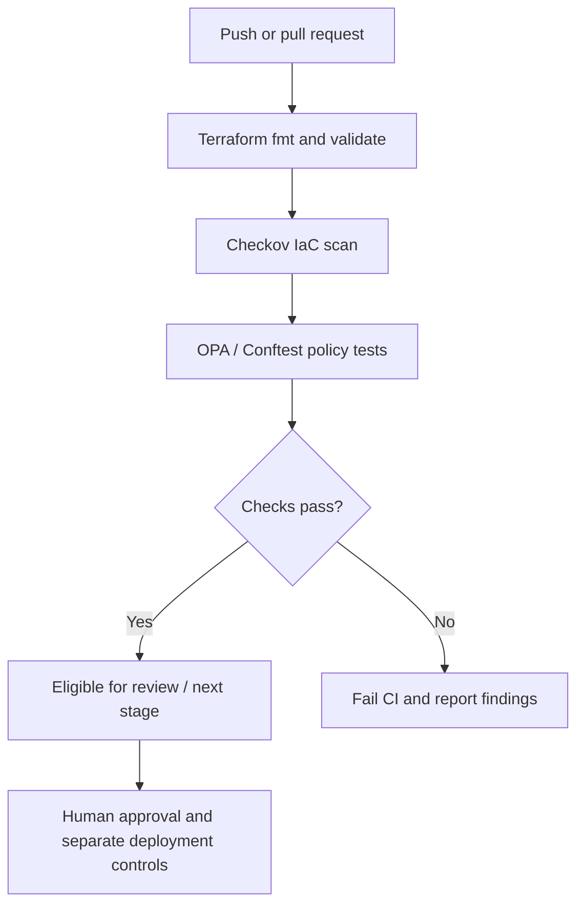

# 🛡️ Terraform Security Policy Gate

### Shift-left security for Azure Infrastructure as Code

[](https://github.com/haqueamir70-coder/terraform-security-policy-gate/actions/workflows/security-gate.yml) [](https://www.terraform.io/) [](https://azure.microsoft.com/) [](https://github.com/features/actions) [](https://www.checkov.io/) [](https://www.openpolicyagent.org/) [](LICENSE)

**A hands-on DevSecOps lab that checks Azure Terraform configuration against security controls before infrastructure changes proceed.**

[Architecture](#architecture) · [Quick Start](#quick-start) · [Policy Controls](#policy-controls) · [CI Pipeline](#ci-pipeline) · [Interview Prep](#interview-ready)

---

## The problem

Terraform can be syntactically valid and still describe insecure infrastructure. This lab demonstrates a preventive policy gate that combines Terraform validation, Checkov static analysis, and custom OPA/Conftest rules.

## What this demonstrates

- Shift-left security checks in pull requests
- Policy as Code using Rego
- Layered assurance with Checkov and OPA/Conftest
- Positive and negative policy test fixtures
- GitHub Actions CI with least-privilege repository permissions
- Reviewable security decisions in version control

## Architecture



**Important:** this workflow does not deploy resources. A passing pipeline means only that configured checks passed for the inputs evaluated; it is not a guarantee of total security or regulatory compliance.

## Technology stack

| Component | Purpose |
|---|---|
| Terraform + AzureRM | Declare Azure infrastructure |
| Checkov | Detect common IaC misconfigurations |
| OPA / Rego | Define organization-specific policy |
| Conftest | Test structured input against policy |
| GitHub Actions | Automate repeatable CI checks |

## Repository layout

```text
.
├── .github/workflows/security-gate.yml
├── infra/
│   ├── main.tf
│   ├── variables.tf
│   └── outputs.tf
├── policy/terraform.rego
├── policy-tests/
│   ├── compliant.json
│   └── noncompliant.json
├── scripts/test-policies.sh
├── .checkov.yaml
├── .gitignore
├── CONTRIBUTING.md
├── LICENSE
├── SECURITY.md
└── README.md
```

## Policy controls

The sample Rego rules explicitly test that the storage-account input disables public nested-item access, enforces HTTPS-only traffic, requires TLS 1.2, and disables public network access. The fixtures test both a compliant example and a deliberately insecure example.

| Control | Expected setting | Reason |
|---|---|---|
| Public nested-item access | Disabled | Prevent anonymous exposure |
| HTTPS-only traffic | Enabled | Protect data in transit |
| Minimum TLS | TLS 1.2 | Avoid obsolete transport security |
| Public network access | Disabled in this lab | Reduce reachable attack surface |

The Terraform resource is a learning example. Network design, private endpoints/DNS, identity, diagnostics, encryption/key lifecycle, and environment-specific requirements must be designed and validated separately before production use.

## Quick start

### Prerequisites

- Git
- Terraform CLI 1.5 or later
- Python 3 and pip for Checkov
- Conftest CLI
- Azure CLI/subscription only if you later choose to deploy the lab

No Azure credentials are needed to run the JSON policy fixtures. Never commit credentials, Terraform state, real secrets, or plan artifacts.

### Validate Terraform

```bash
terraform -chdir=infra fmt -check -recursive
terraform -chdir=infra init -backend=false
terraform -chdir=infra validate
```

### Run Checkov

Use a virtual environment if possible:

```bash
python -m venv .venv
source .venv/bin/activate
# Windows PowerShell: .\\.venv\\Scripts\\Activate.ps1
python -m pip install --upgrade pip checkov
checkov -d infra --config-file .checkov.yaml
```

### Run policy tests

Install Conftest, then run:

```bash
bash scripts/test-policies.sh
```

The script runs both a positive and a negative test: the compliant fixture must pass, while the deliberately insecure storage-account fixture must be rejected. If the insecure fixture unexpectedly passes, the script exits with a non-zero status, causing the CI job to fail. This verifies that the policy gate can detect the sample violations; it does not intentionally make the Terraform deployment configuration insecure.

## CI pipeline

The workflow runs on pushes to `main`, pull requests, and manual dispatch. It contains separate jobs for Terraform format/validation, Checkov scanning, and OPA/Conftest fixture tests. The jobs do not authenticate to Azure or apply Terraform.

For production, additionally pin actions to reviewed commit SHAs and tool versions, use Azure workload identity federation (OIDC), secure remote state and locking, protect the default branch, require reviews/status checks, and implement approved deployment environments.

## Production hardening roadmap

- [ ] Pin GitHub Actions to reviewed full commit SHAs.
- [ ] Use short-lived Azure authentication via OIDC, not long-lived client secrets.
- [ ] Configure secured remote state, locking, access restrictions, and recovery.
- [ ] Expand policies for network exposure, identity permissions, diagnostics, encryption, and approved regions.
- [ ] Add time-bound exceptions with an owner, justification, ticket, and expiry.
- [ ] Publish actionable structured findings and define artifact retention.
- [ ] Test against representative Terraform plan JSON generated by the pinned Terraform version.
- [ ] Review the threat model and applicable standards before making compliance claims.

## Interview-ready

**How would you stop insecure Terraform from reaching production?**

“I would add required checks to pull requests. Terraform validation catches configuration issues, Checkov detects common misconfigurations, and OPA/Conftest enforces organization-specific rules. I would add positive and negative tests, publish actionable findings, and use branch protection to require passing checks. Deployment remains a separate controlled stage with OIDC, secured state, and production approval.”

**Why use Checkov and OPA together?**

“Checkov provides a broad set of known IaC checks. OPA lets platform teams express organization-specific policy as version-controlled code. The tools complement each other and do not replace architecture review or runtime monitoring.”

**Does green CI guarantee security?**

“No. It means the configured checks passed for the inputs evaluated. Coverage, scanner versions, exceptions, architecture context, and runtime behavior still matter.”

## Contributing

Issues and pull requests are welcome. Add rationale and tests when proposing policies. See [CONTRIBUTING.md](CONTRIBUTING.md).

## License

MIT. See [LICENSE](LICENSE).

---

Built as a practical learning reference for Azure, Terraform, DevSecOps, and Policy as Code.
