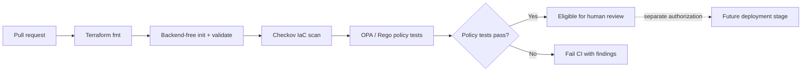

<div align="center">


### Catch misconfiguration early · Enforce policy as code · Fail safely

[](https://github.com/haqueamir70-coder/terraform-security-policy-gate/actions/workflows/security-gate.yml)
[](https://developer.hashicorp.com/terraform)
[](https://www.checkov.io/)
[](https://www.openpolicyagent.org/)
[](https://www.conftest.dev/)

**A credential-free DevSecOps lab that combines Terraform validation, Checkov static analysis and custom OPA/Conftest policy tests to prevent selected insecure Azure Storage configurations from passing CI.**

[Architecture](#-policy-gate-architecture) · [Quick start](#-run-the-gate-locally) · [Policy controls](#-policy-controls) · [CI](#-ci-enforcement-model)

</div>

## The risk

Terraform can be syntactically valid while describing infrastructure with excessive exposure or weak transport settings. This project adds a policy gate before any cloud deployment stage: broad scanner coverage plus explicit organization-specific rules and positive/negative fixtures.

## Policy gate architecture



The workflow is designed to run without Azure credentials and does not deploy resources.

## Policy controls

| Control | Required condition | Risk reduced |
|---|---|---|
| Public nested-item access | Disabled | Accidental anonymous exposure |
| HTTPS-only | Enabled | Insecure transport |
| Minimum TLS | TLS 1.2 | Legacy protocol use |
| Public network access | Disabled for this lab policy | Unnecessary public reachability |

Checkov and OPA serve different purposes: Checkov provides a broad set of predefined IaC checks, while Rego expresses project- or organization-specific rules. Neither replaces threat modelling, architecture review or runtime monitoring.

## Positive and negative testing

The policy fixtures include:
- A **compliant** input expected to pass.
- A deliberately **non-compliant** input expected to be rejected.

The negative test matters: it demonstrates that the gate can detect a known violation, rather than merely proving that a happy-path file passes.

## Run the gate locally

### Prerequisites

- Terraform CLI 1.5+.
- Python 3 and pip for Checkov.
- Conftest CLI.
- Git.

No Azure subscription or credentials are required for the JSON policy fixtures.

### Terraform checks

```bash
terraform -chdir=infra fmt -check -recursive
terraform -chdir=infra init -backend=false
terraform -chdir=infra validate
```

### Checkov

```bash
python -m venv .venv
# Linux / macOS
source .venv/bin/activate
# Windows PowerShell
.venv\Scripts\Activate.ps1
python -m pip install --upgrade pip checkov
checkov -d infra --config-file .checkov.yaml
```

### OPA / Conftest policy tests

After installing Conftest:

```bash
bash scripts/test-policies.sh
```

Expected behavior: the compliant fixture passes and the deliberately insecure fixture is rejected. The script returns a non-zero status if the negative test unexpectedly passes.

## CI enforcement model

Workflow: [`.github/workflows/security-gate.yml`](.github/workflows/security-gate.yml)

The workflow separates Terraform checks, Checkov scanning and OPA/Conftest fixture tests. It does not log in to Azure or run Terraform apply. Review the [Actions history](../../actions) for current results.

A green workflow means the configured checks completed successfully for the files evaluated. It does not prove total security, compliance certification or safe runtime behavior.

## Repository map

```text
.github/workflows/security-gate.yml
infra/                   Terraform sample
policy/                  Rego policy
policy-tests/            Compliant and non-compliant fixtures
scripts/test-policies.sh Local policy test runner
.checkov.yaml            Scanner configuration
CONTRIBUTING.md
SECURITY.md
LICENSE
```

## Production hardening roadmap

- [ ] Pin third-party Actions to reviewed immutable commit SHAs.
- [ ] Expand policies for network exposure, identity, diagnostics, encryption and approved regions.
- [ ] Add time-bound exceptions with an owner, ticket, justification and expiry.
- [ ] Test representative Terraform plan JSON with pinned tool versions.
- [ ] Protect branches and require the policy workflow as a status check.
- [ ] Add OIDC and secured remote state only in a separate approved deployment workflow.
- [ ] Define scanner severity thresholds and a documented exception process.

## Interview scenario

**How would you stop an insecure Terraform change before production?**

Run format and validation checks, scan the IaC with Checkov, enforce organization-specific rules with OPA/Conftest, and test both compliant and deliberately non-compliant fixtures. Require these checks through branch protection. Keep deployment identity, remote state and production approval in a separate protected stage.

## Maintainer

**MD Amirul Haque** · [GitHub](https://github.com/haqueamir70-coder) · [LinkedIn](https://www.linkedin.com/in/md-amirul-haque/)

<sub>Preventive controls are strongest when they are executable, tested and reviewable.</sub>
