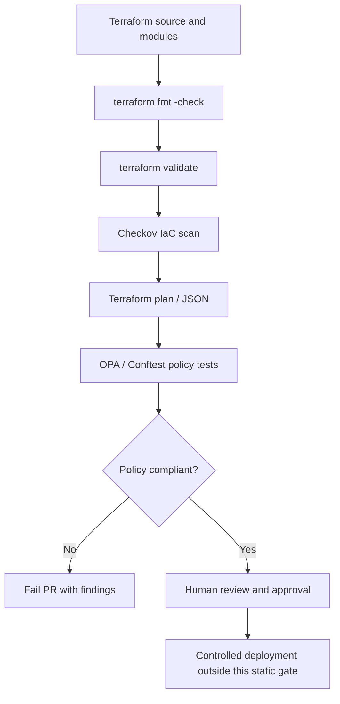

# Terraform security and policy gate — Architecture & Interview Guide

Static infrastructure policy flow using formatting, validation, Checkov and OPA/Conftest fixtures. This gate evaluates configuration; it does not prove deployed cloud security.

## Architecture diagram

## Interview questions

1. 1. What is policy-as-code and why use it in Terraform pipelines?
2. 2. How do Checkov and OPA differ?
3. 3. What is Rego and how are policies evaluated?
4. 4. How do you write positive and negative policy fixtures?
5. 5. Why should a security policy fail closed for critical controls?
6. 6. How do you manage exceptions and expiration dates?
7. 7. What is the difference between plan-time and source-code scanning?
8. 8. How do you avoid false positives without weakening policy?
9. 9. How would you test policies in CI without cloud credentials?
10. 10. What does a passing static scan not guarantee?

## Interview preparation note
Answer with architecture rationale, security controls, operational failure scenarios, observability and test evidence. Clearly label implemented, CI-validated, deployed and planned scope.
